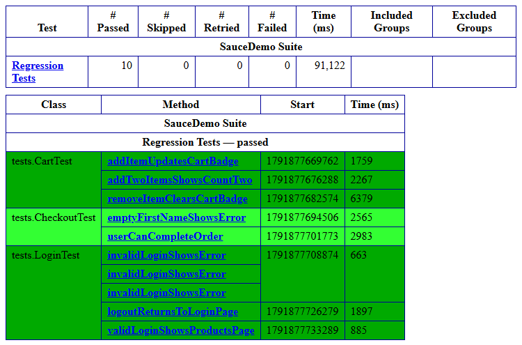
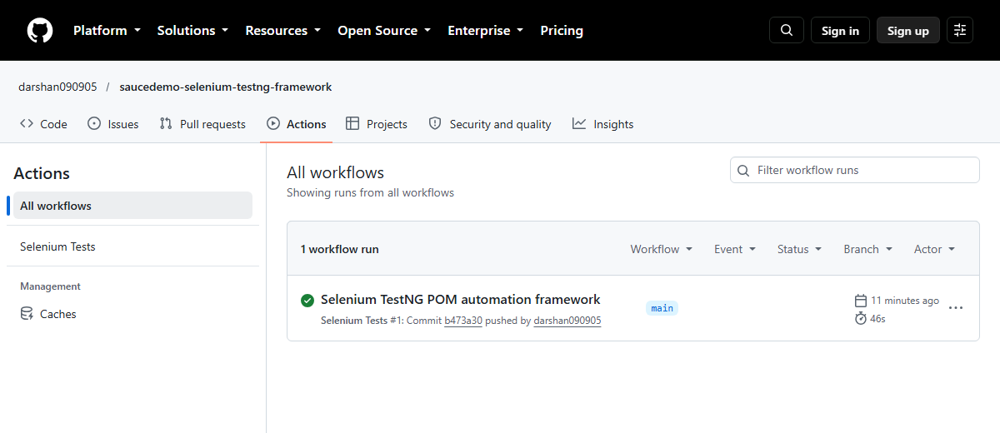

# SauceDemo Web Test Automation Framework

Automated UI tests for https://www.saucedemo.com using Selenium WebDriver, Java, TestNG, and Maven with the Page Object Model.

## Tools
Java 17, Selenium WebDriver 4, TestNG, Maven, GitHub Actions

## What is tested
- Login (valid, invalid, locked-out user, empty username) using a TestNG DataProvider
- Logout
- Cart (add, remove, add multiple items)
- Checkout (complete order, missing first name error)

## How to run
```bash
mvn clean test
```

## CI
Tests run automatically on every push using GitHub Actions (headless Chrome).

## Screenshots

### TestNG Test Execution Report


### GitHub Actions CI Run
